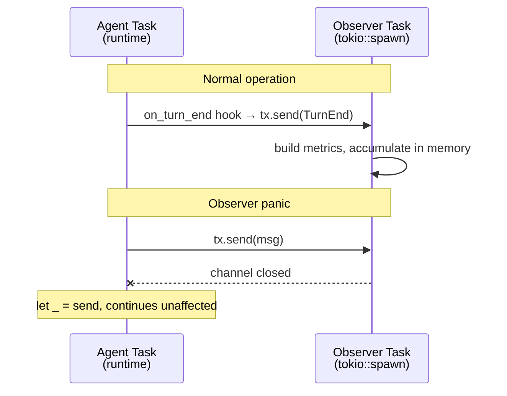

# Observability

phi-agent collects structured metrics automatically. No setup required — every session writes a `session_metrics.json` file alongside the existing session data.

## What's Collected

### Per-turn metrics (`TurnMetrics`)

| Field | Description |
|-------|-------------|
| `turn_number` | Which turn in the session |
| `duration_ms` | Total turn time |
| `time_to_first_token_ms` | Time until first output token (user experience metric) |
| `llm_duration_ms` | Pure LLM time |
| `tool_duration_ms` | Tool execution time |
| `input_tokens` / `output_tokens` | Token usage from LLM response |
| `tool_call_count` / `tools_used` | Which tools ran and how many |
| `tool_success` / `tool_failed` | Tool success/failure counts |
| `outcome` | `completed` / `tool_calls` / `error` / `cancelled` / `max_turns` |
| `has_thinking` | Whether the model used extended thinking |
| `user_input` | Truncated to 80 characters |

### Per-session aggregates (`SessionMetrics`)

| Field | Description |
|-------|-------------|
| `total_turns` | Total turns in session |
| `total_input_tokens` / `total_output_tokens` | Cumulative tokens |
| `estimated_cost` | Cost estimate based on model pricing |
| `tool_breakdown` | Per-tool call counts (e.g. `{"shell": 5, "check_quality": 2}`) |
| `tool_fail_rate` | Fraction of tool calls that failed |
| `p50_turn_ms` / `p95_turn_ms` / `p99_turn_ms` | Latency percentiles |
| `outcome` | `completed` / `failed` / `cancelled` / `max_turns` |
| `error_count` | How many turns ended in error |

## CLI Commands

```bash
# List all sessions on this machine
phi metrics list
# Output:
#   Session                        Turns   Tokens    Cost   Outcome
#   20260729_abc12345 (phi-bard)    5      27,000   $0.18  ✅ completed
#   20260729_def67890 (phi)         3      11,000   $0.06  ✅ completed

# Show detailed breakdown for a session
phi metrics show 20260729_abc12345

# Show the most recent session
phi metrics last
```

## Environment Variables

| Variable | Default | Description |
|----------|---------|-------------|
| `PHI_METRICS_ENABLED` | `true` | Set to `false` to disable metrics entirely (useful for resource-constrained devices) |
| `PHI_NODE_ID` | `""` | Node identifier — distinguishes which machine produced the metrics |
| `PHI_COST_PER_1K_TOKENS` | built-in | Custom model pricing. Format: `input_cost,output_cost` per 1K tokens (e.g. `0.002,0.008`). Falls back to built-in pricing for Claude/GPT models. |

## Custom Business Metrics

The `custom` field lets you inject arbitrary JSON data without the framework knowing about it:

```rust
use phi_telemetry::{init_telemetry, save_metrics};

// Set up telemetry with custom session data
let mut handle = init_telemetry(agent.runtime(), session_id, node_id, model);
handle.set_session_custom(serde_json::json!({
    "product": "my-app",
    "version": "1.0"
}));

// ... agent runs ...

// Shutdown and save
handle.shutdown().await;
let session = handle.session.read().await;
let mut session = session.clone();
session.finalize(SessionOutcome::Completed);
save_metrics(&session, &session_dir)?;
```

Result in `session_metrics.json`:

```json
{
  "session_id": "...",
  "total_turns": 3,
  "custom": {
    "product": "my-app",
    "version": "1.0"
  }
}
```

## Architecture

Observability runs in an **independent tokio task**, communicating with the agent via an mpsc channel:



- Observer panics **never crash the agent** — hook silently drops failed sends
- Metrics accumulate in memory during the session; `save_metrics()` writes to disk after `shutdown()`
- Channel is unbounded — never blocks the agent's hot path

## File Layout

```
~/.phi-agent/sessions/<session_id>/
├── turn_001.jsonl          ← full event stream (dialogue, thinking, tool args/results)
├── turn_002.jsonl
├── session_meta.json       ← session metadata
├── session.log             ← tracing logs
└── session_metrics.json    ← structured metrics (a few KB)
```

## Disabling

```bash
# Disable entirely
export PHI_METRICS_ENABLED=false

# Or disable per-run
PHI_METRICS_ENABLED=false phi "hello"
```
